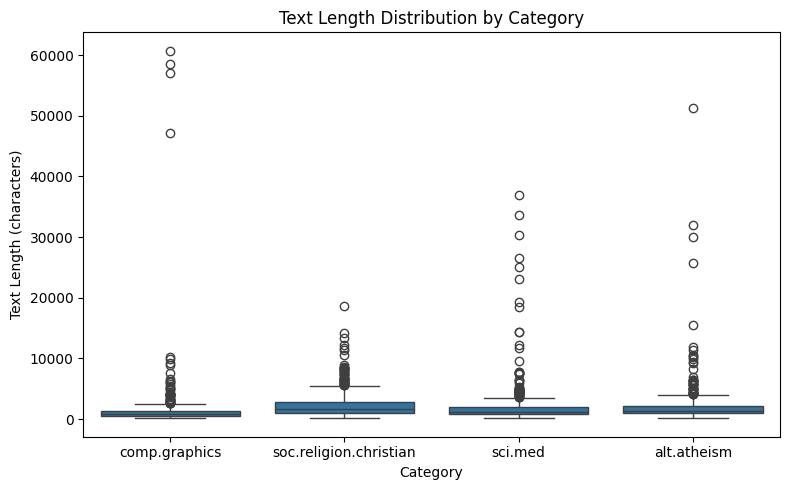
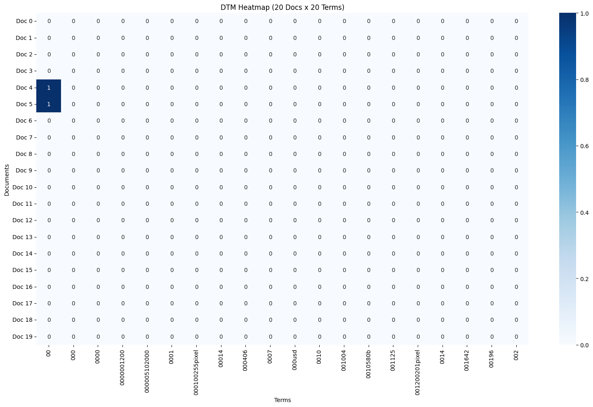
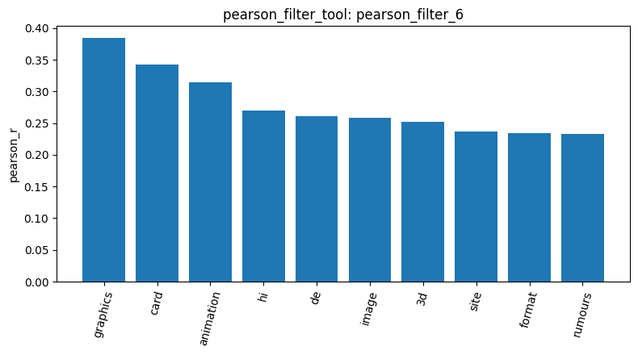
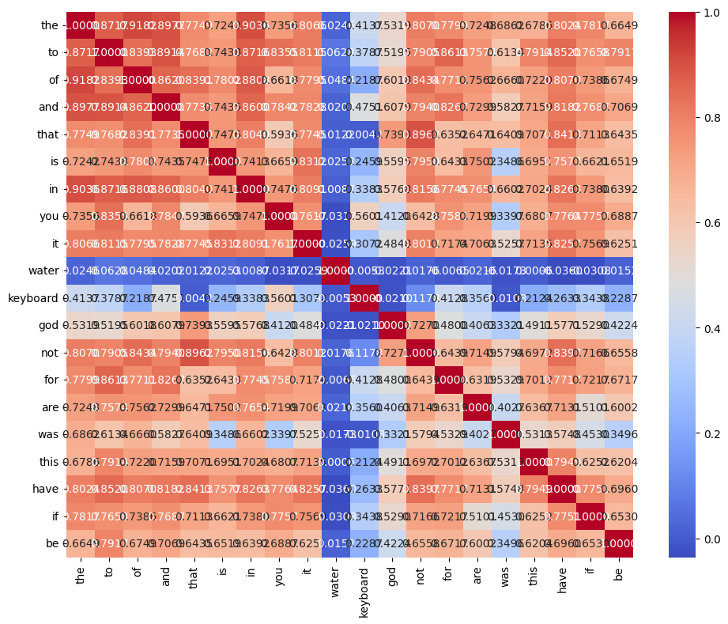
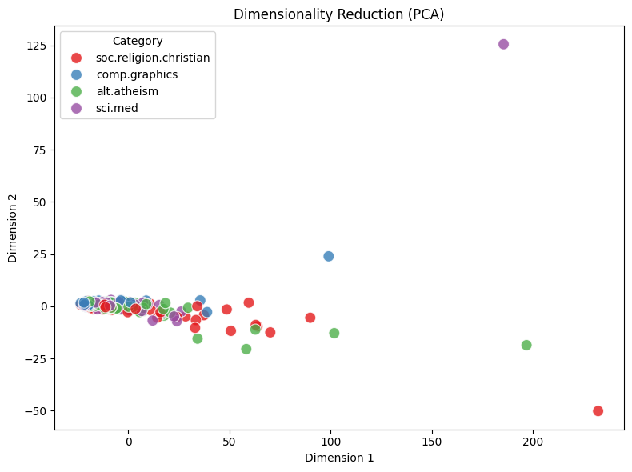

# Your report

<!-- 1 -->
Started loading the dataset for 4 categories: `alt.atheism`, `soc.religion.christian`, `comp.graphics`, and `sci.med`. The total dataset initially had 2,257 documents (`result_id: load_dataset_2`).

<!-- 2 -->
`inspect_data_tool` confirmed that the text bodies and their respective category labels were formatted correctly (`result_id: inspect_2`).

<!-- 3 -->
Then, checks the dataset's cleaning, and it contains zero missing values `check_missing_tool` (`result_id: check_missing_3`).

<!-- 4 -->
No duplicate rows were found from `check_duplicates_tool` (`result_id: check_duplicates_4`).

<!-- 5 -->
Next, used `describe_data_tool` to check the statistics of document lengths (`result_id: describe_5`). Overall average length = 1,993 words.

`soc.religion.christian` has the highest average length, while `comp.graphics` has the shortest average length but contains the longest single document (over 60,000 words).

<!-- 6 -->
To optimize the processing context, I used `sample_data_tool` to randomly select a balanced subset of 200 documents (`result_id: sample_3`).

<!-- 7 -->
After verifying the data, I built a Document-Term Matrix (DTM) using `build_dtm_tool` from the sampled 200 documents (`result_id: dtm_4`). The resulting matrix extracted 9,612 unique terms. The matrix remains highly sparse (approximately 98.24% sparsity), meaning most documents only use a very small fraction of the total vocabulary.

<!-- 8 -->
To understand the contents of the text, I previously ran `term_frequency_tool` on the full data (`result_id: tf_7`). The top 20 most frequent terms were common English stop words (e.g., "the", "of", "to"), which do not carry much domain-specific meaning. 

<!-- 9 -->
Visualizing a 20x20 slice of the matrix using `dtm_heatmap_tool` (`result_id: dtm_heatmap_8`) revealed extreme sparsity. The slice was heavily populated by zeroes and obscure numerical terms like "000usd" or "00100255pixel". 

<!-- 10 -->
To address the extreme sparsity, reduce noise, and resolve API context length limitations, I applied the `variance_filter_tool` with a highly aggressive threshold of 0.20 (`result_id: variance_filter_5`) on the generated DTM (`result_id: dtm_4`). This successfully filtered out 9,144 near-constant or extremely rare terms from the 200-document subset, leaving a very compact and manageable set of 468 features for the correlation analysis.

<!-- 11 -->
Next, I applied the `pearson_filter_tool` targeting the `comp.graphics` category (`result_id: pearson_filter_6`) to find the terms most highly correlated with this topic. The tool successfully identified domain-specific terms, with the top 3 being "graphics" (r ≈ 0.384), "card" (r ≈ 0.342), and "animation" (r ≈ 0.315). This confirms that the filtering successfully surfaced relevant features for the computer graphics category despite the reduced sample size.

<!-- 12 -->
I used the `visualize_result_tool` to generate a bar chart of the top 10 correlated terms, which visually confirmed that the filtering surfaced relevant features for the computer graphics category despite the reduced sample size.
 

<!-- 12 -->
To observe the relationships among the top extracted features, I generated a correlation matrix using the `feature_correlation_matrix_tool` (`result_id: feature_correlation_matrix_7`). 

The visualization displays the correlations between top 20 features. While our targeted terms are present, the matrix also reveals high positive co-occurrence correlations among remaining common stop-words (such as "the", "to", "and", "of"). This suggests that for a production-level model, implementing a stricter stop-word removal preprocessing step would further improve feature quality.

<!-- 13 -->
Next, used the `visualize_result_tool` to generate a bar chart of the Pearson correlation results (`result_id: pearson_filter_6`). The chart plots the top 10 terms most positively correlated with the `comp.graphics` category, providing a clear visual representation of the features strongly associated with this topic.

<!-- 14 -->
To discover common word combinations, I applied the `mine_patterns_tool` (`result_id: mine_patterns_9`) to the `comp.graphics` category using the FP-Growth algorithm (minimum support = 5, filtered by variance). The tool successfully identified 943 frequent patterns. The most common patterns were dominated by newsgroup header metadata (e.g., ['lines', 'subject'] and ['organization']), but it also successfully mined relevant content-specific associations like ['card'] and ['help'].

<!-- 15 -->
Next, applied Principal Component Analysis (PCA) via `reduce_dimensions_tool` (`result_id: reduce_dimensions_8`) to compress the filtered dataset down to 2 components for visualization. The first two components successfully captured 66.60% of the total variance, indicating a strong underlying structure despite the extreme dimensionality reduction. 

<!-- 16 -->
To prepare the target variable for potential binary classification, I used the `binarize_labels_tool` (`result_id: binarize_labels_10`). I set `comp.graphics` as the positive class, which resulted in 44 positive instances and 156 negative instances across the 200 sampled documents.

<!-- 17 -->
Finally, used the `cosine_similarity_tool` (`result_id: cosine_similarity_11`) to compute the similarity between document index 0 and 1 from the sampled matrix (`dtm_4`). The resulting cosine similarity score was 0.4779, indicating a moderate level of textual overlap between the two specific documents.