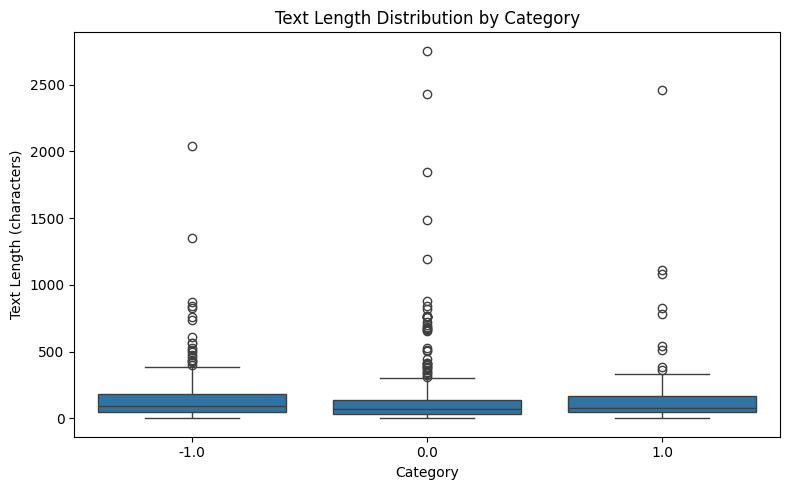
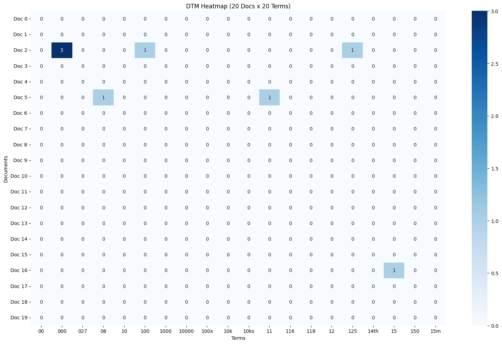
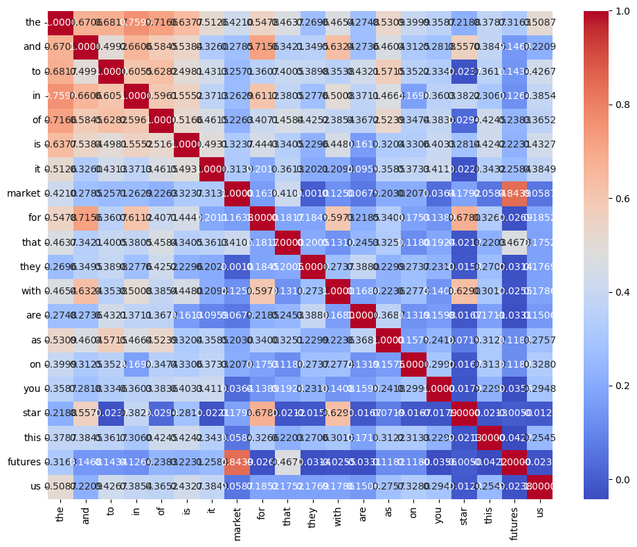
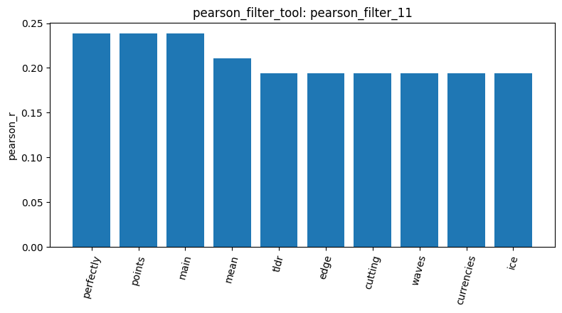
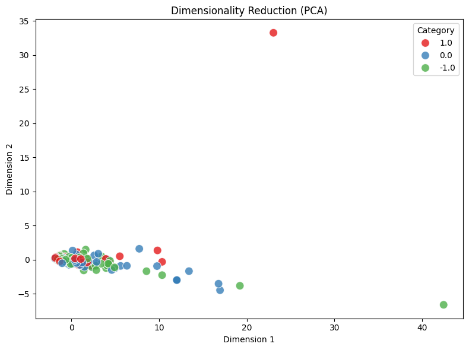

# Your report

<!-- 1 -->
Started loading the Reddit stock sentiment dataset using `load_dataset_tool` (`result_id: load_dataset_1`). The dataset contains 847 documents across three sentiment categories: 423 neutral (`0.0`), 315 negative (`-1.0`), and 109 positive (`1.0`).

<!-- 2 -->
To understand the structure of the newly loaded Reddit stock sentiment dataset, used `inspect_data_tool` (`result_id: inspect_2`). The inspection confirmed the dataset contains 847 rows with `text` and `category_name` columns. The labels correctly reflect the three sentiment classes: -1.0 (negative), 0.0 (neutral), and 1.0 (positive).

<!-- 3 -->
Then, ran the `check_missing_tool` (`result_id: check_missing_3`) to verify data quality. The check confirmed that the dataset is clean, with 0 missing values across all 847 documents.

<!-- 4 -->
Using `check_duplicates_tool` (`result_id: check_duplicates_4`), discovered 34 duplicate rows within the dataset. These duplicates were not dropped, keeping the total document count at 847.

<!-- 5 -->
Next, ran `describe_data_tool` (`result_id: describe_5`) to analyze the document lengths. The overall average text length is quite short at approximately 148 characters. The maximum length found is 2,753 characters. The distribution of document lengths is relatively consistent across all three sentiment labels (-1.0, 0.0, and 1.0).

<!-- 6 -->
To optimize processing and ensure we stay within the LLM context limits, used `sample_data_tool` (`result_id: sample_2`) to randomly select a subset of 400 documents from the dataset for the remaining steps of the analysis.

<!-- 7 -->
After sampling 400 rows, built a Document-Term Matrix (DTM) using the `build_dtm_tool` (`result_id: dtm_3`). The matrix extracted 2,789 unique terms from the Reddit stock sentiment dataset. The matrix exhibits a sparsity of 99.25%, reflecting the short and concise nature of Reddit comments.

<!-- 8 -->
To understand the most common vocabulary in the corpus, I used `term_frequency_tool` (`result_id: tf_7`). The most frequent words across the 400 sampled documents were heavily dominated by common stop words, with the top 5 being "the" (380 occurrences), "to" (239), "and" (209), "is" (188), and "of" (147).

<!-- 9 -->
Next, I visualized a 20x20 slice of the matrix using `dtm_heatmap_tool` (`result_id: dtm_heatmap_9`). The resulting heatmap visually confirms the extreme sparsity of the text data (approximately 99.25% sparse), with only a handful of non-zero entries appearing in this subset.

<!-- 10 -->
To reduce noise and address this sparsity, I applied the `variance_filter_tool` with a threshold of 0.01 (`result_id: variance_filter_4`). This successfully removed 2,308 near-constant or extremely rare terms, reducing the feature space from 2,789 down to a more meaningful set of 481 terms.

<!-- 11 -->
Applied the `pearson_filter_tool` targeting category `1.0` (positive sentiment) using the filtered matrix from variance_filter_tool. The analysis produced `result_id: pearson_filter_11`. The top 5 terms most positively correlated with positive sentiment are:
* "perfectly" (Pearson r ≈ 0.238)
* "points" (Pearson r ≈ 0.238)
* "main" (Pearson r ≈ 0.238)
* "mean" (Pearson r ≈ 0.210)
* "tldr" (Pearson r ≈ 0.194)

<!-- 12 -->
Next, generated a Feature Correlation Matrix `feature_correlation_matrix_tool` using the top terms from the Pearson filter (`result_id: feature_correlation_matrix_12`). The resulting 20x20 matrix visualizes the pairwise Pearson correlation coefficients between features such as "the", "market", "futures", and others.

<!-- 13 -->
To clearly illustrate these correlation scores, I applied the `visualize_result_tool` on the Pearson filter results (`pearson_filter_11`). This produced a bar chart displaying the top 10 features and their correlation scores with the positive sentiment class.

<!-- 14 -->
For pattern mining, I used the `mine_patterns_tool` on the variance-filtered matrix (`result_id: variance_filter_10`), specifically targeting the positive sentiment category (`1.0`). Using the FP-Growth algorithm with a minimum support of 2, the tool discovered 193 frequent patterns (`result_id: mine_patterns_13`). Notable patterns included single items like `['good']` (support: 5) and multi-item combinations such as `['currencies', 'mean']`.

<!-- 15 -->
To visualize the overall dataset structure, I used the `reduce_dimensions_tool` to apply Principal Component Analysis (PCA) on the 400 samples (`result_id: reduce_dimensions_14`). The data was reduced to 2 components, which together explained 37.30% of the total variance (Component 1: 30.20%, Component 2: 7.10%).

<!-- 16 -->
To prepare the dataset for binary classification, I applied the `binarize_labels_tool` setting the positive sentiment (`"1.0"`) as the target positive class (`result_id: binarize_labels_5`). The tool successfully converted the labels, resulting in 65 positive documents and 335 non-positive (negative/neutral) documents from the working sample.

<!-- 17 -->
Finally, I evaluated document-level similarity using the `cosine_similarity_tool` (`result_id: cosine_similarity_6`). By comparing document index 0 and document index 1 from the variance-filtered matrix (`variance_filter_4`), the cosine similarity score was exactly 0.0. This indicates that these two specific Reddit posts share absolutely no overlapping vocabulary within the filtered feature space.